# DRIPLARE AI → Full CRM Platform: সম্পূর্ণ আপগ্রেড প্ল্যান

> **বিশ্লেষণ তারিখ:** ২৭ অক্টোবর ২০২৬  
> **Codex Analysis File:** `docs/feature-update/CRM/crm-platform-upgrade-analysis.md`  
> **Deep Project Scan:** Prisma schemas, API routes, components, Sidebar, Automations catalog, Locales

---

## ১. বর্তমান অবস্থার সংক্ষিপ্ত X-Ray

### কী আছে (শক্তিশালী দিক)

| এরিয়া | বর্তমান অবস্থা |
|--------|----------------|
| **Omnichannel Inbox** | Facebook, WhatsApp, Instagram, Web — human/AI handoff, snooze, archive, assignment |
| **Order Management** | Manual order, COD tracking, Steadfast/Pathao/RedX courier, cancellation/return flow |
| **Products** | FB post AI-extract, manual, CSV import, stock integer, variant JSON, RAG embedding |
| **Automations** | Rule/Flow engine, broadcasts, templates, comment automation, frequency cap, quiet hours |
| **Leads page** | ChatSession-based list, search, filter, pagination, CSV export, CRM Drawer |
| **CRM Drawer** | Contact info, AI score, order history, staff notes |
| **Analytics** | Sessions, leads (= sessions with name), messages, COD, cancellation reasons, sentiment |
| **Team** | Workspace, WorkspaceMember (admin/agent/viewer), session assignment |

### কী নেই (Critical Gaps)

```
❌ Stable Contact model — customer = ChatSession (একই ব্যক্তি = duplicate rows)
❌ Deal / Pipeline model — কোনো sales opportunity tracking নেই
❌ Task / Activity model — follow-up, due date, reminder নেই
❌ Contact ↔ Order linkage — Order-এ contactId নেই, শুধু sessionId (plain string)
❌ Variant-level inventory — stock = 1 integer, no movement history
❌ Consent / opt-out fields — broadcast করার আগে consent check নেই
❌ CRM audit trail — কে কী change করেছে তার history নেই
❌ Workspace-wide CRM query — API-তে chatbotId বাধ্যতামূলক
❌ Saved views / segments — dynamic segment নেই
❌ i18n for CRM — leads page সম্পূর্ণ hardcoded English, কোনো namespace নেই
❌ Contact 360 page — শুধু Drawer আছে, full profile page নেই
❌ Pipeline KPI — funnel, win/loss, conversion rate নেই
❌ CustomerProfile data lifecycle — orphan profile, export incomplete
```

---

## ২. Data Model: যা বদলাতে হবে

> [!CAUTION]
> নিচের schema changes migration-সহ করতে হবে। Existing data backward-compatible রাখা জরুরি। Production-এ migrate করার আগে test branch-এ যাচাই করুন।

### Phase 1: Contact Foundation (সবচেয়ে জরুরি)

#### নতুন `Contact` model (merchant.prisma)

```prisma
// ── Canonical Customer Identity (CRM Core) ─────────────────────────────────
// ChatSession-ভিত্তিক CustomerProfile কে replace করবে।
// একজন ব্যক্তি যতটি channel/session-এই কথা বলুক — একটিই Contact row।
model Contact {
  id             String   @id @default(cuid())
  contactId      String   @unique @default(cuid())
  workspaceId    String
  
  // Core identity
  name           String?
  email          String?
  phone          String?  // normalized, verified
  profilePhoto   String?
  
  // Lifecycle: new | engaged | qualified | customer | repeat | lapsed
  lifecycleStage String   @default("new")
  
  // Attribution
  source         String?  // facebook | whatsapp | web | manual | import
  referral       String?
  assignedToUserId String? // WorkspaceMember.userId
  
  // Consent (GDPR/local compliance)
  marketingConsent Boolean @default(false)
  smsConsent       Boolean @default(false)
  consentUpdatedAt DateTime?
  optedOutAt       DateTime?
  
  // Custom fields (flexible JSON for merchant-specific data)
  customFields   Json?    @default("{}")
  
  // Tags (separate from session tags)
  tags           ContactTagAssignment[]
  
  createdAt      DateTime @default(now())
  updatedAt      DateTime @updatedAt
  
  // Relations
  identities     ContactIdentity[]
  deals          Deal[]
  tasks          CrmTask[]
  activities     CrmActivity[]
  // Orders will link via contactId (nullable migration)
  
  @@index([workspaceId])
  @@index([workspaceId, lifecycleStage])
  @@index([phone])
  @@index([email])
  @@schema("crm")
}

// প্রতিটি channel account = একটি ContactIdentity
model ContactIdentity {
  id          String   @id @default(cuid())
  contactId   String
  channel     String   // facebook | whatsapp | instagram | web
  externalId  String   // PSID / WA number / web sessionId
  chatbotId   String?
  sessionId   String?  // links back to ChatSession
  verified    Boolean  @default(false)
  createdAt   DateTime @default(now())
  
  contact     Contact  @relation(fields: [contactId], references: [contactId], onDelete: Cascade)
  
  @@unique([channel, externalId])
  @@index([contactId])
  @@index([sessionId])
  @@schema("crm")
}
```

#### নতুন `Deal` model

```prisma
// ── Sales Deal / Opportunity ───────────────────────────────────────────────
model Deal {
  id           String   @id @default(cuid())
  dealId       String   @unique @default(cuid())
  workspaceId  String
  contactId    String
  
  title        String
  amount       Float?
  currency     String   @default("BDT")
  probability  Int?     // 0-100
  
  // Pipeline
  pipelineId   String?  // future: multiple pipelines
  stage        String   @default("new") // new | contacted | qualified | proposal | won | lost
  lostReason   String?
  
  expectedCloseDate DateTime?
  closedAt          DateTime?
  assignedToUserId  String?
  
  source       String?
  
  createdAt    DateTime @default(now())
  updatedAt    DateTime @updatedAt
  
  contact      Contact  @relation(fields: [contactId], references: [contactId])
  tasks        CrmTask[]
  activities   CrmActivity[]
  stageHistory DealStageHistory[]
  
  @@index([workspaceId, stage])
  @@index([contactId])
  @@schema("crm")
}

model DealStageHistory {
  id        String   @id @default(cuid())
  dealId    String
  fromStage String?
  toStage   String
  changedBy String?  // userId
  createdAt DateTime @default(now())
  deal      Deal     @relation(fields: [dealId], references: [dealId], onDelete: Cascade)
  @@schema("crm")
}
```

#### নতুন `CrmTask` ও `CrmActivity` model

```prisma
// ── CRM Tasks (Follow-ups, Calls, Meetings) ────────────────────────────────
model CrmTask {
  id           String   @id @default(cuid())
  taskId       String   @unique @default(cuid())
  workspaceId  String
  
  title        String
  description  String?  @db.Text
  type         String   @default("follow_up") // follow_up | call | meeting | email | note
  
  priority     String   @default("medium") // low | medium | high
  status       String   @default("pending") // pending | done | overdue | cancelled
  
  dueAt        DateTime?
  completedAt  DateTime?
  
  assignedToUserId String?
  
  // Can be linked to Contact, Deal, or both
  contactId    String?
  dealId       String?
  
  createdAt    DateTime @default(now())
  updatedAt    DateTime @updatedAt
  
  contact      Contact? @relation(fields: [contactId], references: [contactId])
  deal         Deal?    @relation(fields: [dealId], references: [dealId])
  
  @@index([workspaceId, status, dueAt])
  @@index([assignedToUserId])
  @@schema("crm")
}

// ── Unified Activity Timeline ──────────────────────────────────────────────
// System events + manual entries সব এখানে
model CrmActivity {
  id           String   @id @default(cuid())
  workspaceId  String
  
  // Event type: message | note | task_done | deal_stage | order_placed | 
  //             order_delivered | identity_merged | owner_changed | call | meeting
  eventType    String
  
  summary      String?  @db.Text
  metadata     Json?    // flexible payload per eventType
  
  contactId    String?
  dealId       String?
  sessionId    String?  // links to ChatSession if messaging event
  orderId      String?  // links to Order if commerce event
  
  actorUserId  String?  // null = system/automation
  createdAt    DateTime @default(now())
  
  contact      Contact? @relation(fields: [contactId], references: [contactId])
  deal         Deal?    @relation(fields: [dealId], references: [dealId])
  
  @@index([contactId, createdAt])
  @@index([workspaceId, createdAt])
  @@schema("crm")
}
```

#### Order model এ `contactId` যোগ (merchant.prisma migration)

```prisma
// Order model-এ এই field যোগ করতে হবে (nullable — backward compatible):
contactId   String?  // Contact.contactId — stable after identity linking
// @@index([contactId]) যোগ করতে হবে
```

#### Product model Variant normalize

```prisma
// Product model-এ variant JSON কে আলাদা model করতে হবে:
model ProductVariant {
  id          String   @id @default(cuid())
  productId   String
  sku         String?
  options     Json     // { color: "Red", size: "M" }
  stock       Int      @default(0)
  price       Float?
  // inventory movement history
  movements   InventoryMovement[]
  product     Product  @relation(fields: [productId], references: [productId], onDelete: Cascade)
  @@schema("ecommerce")
}

model InventoryMovement {
  id        String   @id @default(cuid())
  variantId String
  type      String   // restock | sale | adjustment | return | reserve | release
  qty       Int      // positive = in, negative = out
  reason    String?
  actorId   String?
  orderId   String?
  createdAt DateTime @default(now())
  variant   ProductVariant @relation(fields: [variantId], references: [id])
  @@schema("ecommerce")
}
```

---

## ৩. API Routes: যা যোগ/পরিবর্তন করতে হবে

### নতুন CRM API endpoints

```
/api/crm/contacts          GET (workspace-wide, filter, paginate), POST (create)
/api/crm/contacts/[id]     GET, PATCH, DELETE
/api/crm/contacts/[id]/merge  POST (duplicate merge)
/api/crm/contacts/[id]/timeline GET (unified activity)
/api/crm/contacts/import   POST (CSV/bulk)

/api/crm/deals             GET (filter by stage/owner), POST
/api/crm/deals/[id]        GET, PATCH
/api/crm/deals/[id]/stage  PATCH (stage change → logs DealStageHistory + CrmActivity)

/api/crm/tasks             GET (filter by assignee/due/status), POST
/api/crm/tasks/[id]        PATCH (complete, reassign)

/api/crm/segments          GET, POST (dynamic segment definition)
/api/crm/segments/[id]/preview GET (resolve contacts count)

/api/analytics/crm         GET (pipeline KPIs, funnel, LTV, win/loss)
```

### পরিবর্তন দরকার যে APIগুলোতে

| API | সমস্যা | সমাধান |
|-----|--------|--------|
| `/api/crm/customers` | `chatbotId` mandatory, session-based | workspace-wide query + Contact model |
| `/api/analytics/overview` | `totalLeads` = ChatSession count | Contact count + Deal pipeline value |
| `/api/user/export` | CRM data বাদ, শুধু 20 sessions | Contact, Deal, Task, Order সব include |
| `/api/user/delete` | CustomerProfile cleanup নেই | Contact cascade delete যোগ |

---

## ৪. UI পরিবর্তন (বিস্তারিত)

### ৪.১ Sidebar Restructure

**বর্তমান:** "Main Operations" → Overview, Live Inbox, Leads & Customers

**নতুন প্রস্তাব:**

```
📊 OVERVIEW
  └── Overview Dashboard

💬 INBOX
  └── Live Inbox

👥 CRM                          ← নতুন collapsible group
  ├── Contacts                  ← /dashboard/contacts
  ├── Deals & Pipeline          ← /dashboard/deals
  └── Tasks & Follow-ups        ← /dashboard/tasks

🛍️ E-COMMERCE
  ├── Products
  ├── Orders
  ├── Couriers
  └── Discounts

⚡ AUTOMATIONS
  ├── Rules
  ├── Broadcasts
  ├── Templates
  └── Activity Log

🤖 AI ENGINE
  ├── AI Agents
  ├── Knowledge Base
  └── Platforms
```

> [!IMPORTANT]
> "Leads & Customers" → "Contacts" rename করতে হবে। `/dashboard/leads` → `/dashboard/contacts` redirect সহ (backward compat)।

### ৪.২ Contacts List Page (Leads page redesign)

**বর্তমানে missing:**
- Workspace-wide query (chatbot-agnostic)
- Saved views (New, Unassigned, High Intent, Repeat Customers)
- Lifecycle stage column + filter
- Bulk actions (assign, tag, export, stage update)
- `Create Contact` button (manual add)
- `Import` button (CSV preview + validation)
- Column customization
- Export clarity (current page vs all filtered)

**নতুন UI elements:**
```
┌─ Contacts ─────────────────────────────────── + Create  ↑ Import  ↓ Export ┐
│ [Saved Views: All | New | Unassigned | High Intent | Repeat]                │
│                                                                              │
│ Search... | Stage ▼ | Owner ▼ | Channel ▼ | Last Activity ▼ | [Apply]       │
│                                                                              │
│ ☐ | Avatar | Name | Phone | Stage | Owner | Channel | Orders | LTV | Action │
│ ──────────────────────────────────────────────────────────────────────────  │
│ ☐ | 🖼️  | Rahim | 017xx | Customer | Me | FB | 3 | ৳4,500 | [View] [Deal] │
└──────────────────────────────────────────────────────────────────────────────┘
```

### ৪.³ Contact 360 Profile Page

নতুন `/dashboard/contacts/[contactId]` full page:

```
┌─ Header: Avatar | Name | Lifecycle Badge | Owner | Channel badges ──────────┐
│  [Edit] [Create Deal] [Add Task] [Send Message] [Merge] [Delete]             │
├─ Tabs ─────────────────────────────────────────────────────────────────────  │
│  Overview | Timeline | Conversations | Orders | Deals & Tasks                │
├─ Overview Tab ──────────────────────────────────────────────────────────────  │
│  Left: Properties (name, phone, email, address, source, consent toggle)      │
│  Right: Stats (total orders, LTV, last active, open deals, overdue tasks)    │
├─ Timeline Tab ──────────────────────────────────────────────────────────────  │
│  Chronological feed: 💬 message received → 📦 order placed → ✅ task done   │
│  → 🔀 deal stage changed → 👤 owner changed → 📝 note added                 │
├─ Conversations Tab ─────────────────────────────────────────────────────────  │
│  All linked ChatSessions (FB, WA, IG, Web) with last message preview         │
│  [Open in Inbox] button per session                                           │
├─ Orders Tab ────────────────────────────────────────────────────────────────  │
│  Full order history with items, payment, delivery, COD status                 │
└─ Deals & Tasks Tab ─────────────────────────────────────────────────────────  │
   Open deals + upcoming/overdue tasks for this contact                         │
```

> [!NOTE]
> `CustomerCrmDrawer` কে quick-preview drawer হিসেবে রাখা যায় (inbox-এ ব্যবহারের জন্য)। Full profile = আলাদা page।

### ৪.৪ Deals & Pipeline Page

**নতুন `/dashboard/deals`:**

````carousel
**Kanban View (default)**

```
New → Contacted → Qualified → Proposal → Won | Lost

[+ Add Deal]

┌─ New (3) ─┐  ┌─ Contacted (5) ─┐  ┌─ Qualified (2) ─┐ ...
│ Rahim     │  │ Karim           │  │ Salma           │
│ ৳5,000   │  │ ৳12,000         │  │ ৳8,500          │
│ 📅 3 days │  │ ⚠️ Overdue       │  │ ✅ Task set     │
└───────────┘  └─────────────────┘  └─────────────────┘
```
<!-- slide -->
**Table View (toggle)**

```
Title | Contact | Stage | Amount | Close Date | Owner | Next Task | Action
─────────────────────────────────────────────────────────────────────────
...
```
````

### ৪.৫ Tasks & Follow-ups Page

**নতুন `/dashboard/tasks`:**
- Tab: Due Today | Overdue | This Week | All
- Filter: Assignee, Priority, Related Contact/Deal
- Quick complete button (inline)
- Calendar view toggle
- Overdue count badge on sidebar nav item

### ৪.৬ CRM Overview Dashboard (Overview page upgrade)

**বর্তমান overview:** Session count, message count, COD, cancellations

**নতুন CRM KPIs যোগ করতে হবে:**

```
┌─ Pipeline Value ─┐ ┌─ New Contacts ─┐ ┌─ Open Deals ─┐ ┌─ Overdue Tasks ─┐
│ ৳2,45,000        │ │ 47 this week   │ │ 23           │ │ 8 ⚠️             │
└──────────────────┘ └────────────────┘ └──────────────┘ └─────────────────┘

┌─ Funnel Chart ──────────────────┐ ┌─ Win/Loss Rate ────────────────────────┐
│ New → Contacted → Qualified →   │ │ Won: 68% | Lost: 32% this month        │
│ Customer (conversion %)         │ │ Top lost reason: Price                 │
└─────────────────────────────────┘ └────────────────────────────────────────┘

┌─ Repeat Purchase Rate ──────────┐ ┌─ Avg Response Time ────────────────────┐
│ 34% customers ordered 2+ times  │ │ First reply: 4 min | Follow-up: 2.1 hr │
└─────────────────────────────────┘ └────────────────────────────────────────┘
```

---

## ৫. Automation Engine: CRM triggers/actions যোগ

### নতুন Trigger types (automation schema-তে)

```typescript
// TRIGGER_TYPES এ যোগ করতে হবে:
| "contact.created"
| "contact.lifecycle_changed"
| "deal.created"
| "deal.stage_changed"
| "deal.won"
| "deal.lost"
| "task.overdue"
| "contact.no_activity"    // X দিন কোনো interaction নেই
| "contact.order_delivered"
| "contact.repeat_purchase"
| "contact.lapsed"         // N দিন কোনো order নেই
```

### নতুন Action types

```typescript
// ACTION_TYPES এ যোগ করতে হবে:
| "create_task"            // { title, type, dueOffsetDays, assignTo }
| "create_deal"            // { title, stage, amount }
| "update_lifecycle"       // { stage }
| "update_deal_stage"      // { toStage }
| "send_internal_alert"    // { message, toUserId }
```

---

## ৬. i18n: নতুন namespace দরকার

> [!WARNING]
> Leads page সম্পূর্ণ hardcoded English। নতুন CRM section-এর জন্য আলাদা namespace তৈরি করতে হবে।

```
public/locales/en/crm.json          ← Contact, Deal, Task labels (EN)
public/locales/bn/crm.json          ← same in Bengali
public/locales/en/pipeline.json     ← Deal stage labels (EN)
public/locales/bn/pipeline.json     ← same in Bengali

বিদ্যমান leads-specific text → crm.json এ migrate করতে হবে
```

---

## ৭. ভিত্তিগত সমস্যা: Data Lifecycle (সবচেয়ে আগে ঠিক করতে হবে)

| সমস্যা | ঝুঁকি | সমাধান |
|--------|-------|--------|
| `CustomerProfile.workspaceId` → `Workspace` relation নেই | Orphan profiles | FK relation + cascade |
| Account delete → CustomerProfile cleanup নেই | Data leak | `/api/user/delete` এ Contact cascade |
| Export শুধু 20 sessions, CRM data বাদ | GDPR compliance fail | Contact + Deal + Task export যোগ |
| Broadcast consent check নেই | Spam risk | Contact.marketingConsent field + audience filter |
| CRM change history নেই | Audit trail missing | CrmActivity model দিয়ে cover হবে |

---

## ৮. Phase-by-Phase Roadmap

```mermaid
flowchart TD
    P1["Phase 1 — Data Foundation\n(সবচেয়ে জরুরি)"]
    P2["Phase 2 — Daily Sales CRM\n(Core workflow)"]
    P3["Phase 3 — Retention & Reporting\n(Growth layer)"]
    P4["Phase 4 — Advanced\n(Future)"]

    P1 --> A1["Contact + ContactIdentity model\n(Prisma schema + migration)"]
    P1 --> A2["Order.contactId migration\n(nullable, backfill via sessionId)"]
    P1 --> A3["CrmActivity model\n(unified timeline)"]
    P1 --> A4["Data lifecycle fix\n(export, delete, consent fields)"]
    P1 --> A5["Workspace-wide /api/crm/contacts API\n(no chatbotId required)"]

    P2 --> B1["Deal + Pipeline model\nKanban board UI"]
    P2 --> B2["CrmTask model\nTask list + calendar"]
    P2 --> B3["Contact 360 page\n/dashboard/contacts/[id]"]
    P2 --> B4["Contacts list redesign\nSaved views, bulk actions, import"]
    P2 --> B5["Sidebar CRM group\nNew navigation structure"]

    P3 --> C1["Dynamic segments\n+ consent-aware broadcast"]
    P3 --> C2["CRM analytics\nFunnel, pipeline velocity, LTV"]
    P3 --> C3["CRM automation triggers\n(deal.stage_changed, task.overdue, etc.)"]
    P3 --> C4["i18n namespace\ncrm.json + pipeline.json"]

    P4 --> D1["ProductVariant model\n+ InventoryMovement"]
    P4 --> D2["Company / Account model\n(B2B)"]
    P4 --> D3["Public API / Webhooks\nExternal integrations"]
    P4 --> D4["Support Ticket / SLA\n(durable issue tracking)"]
```



---

## ৯. Technology Stack Impact

| Layer | Impact |
|-------|--------|
| **Prisma Schema** | নতুন `crm` schema namespace — Contact, ContactIdentity, Deal, DealStageHistory, CrmTask, CrmActivity; ProductVariant, InventoryMovement (`ecommerce` schema) |
| **Database** | Migration সহ নতুন tables; Order-এ nullable `contactId` column; Product JSON variants → normalized |
| **API Routes** | 10+ নতুন CRM endpoints; 4টি বিদ্যমান API পরিবর্তন |
| **Components** | ContactList (redesign), Contact360Page (নতুন), DealBoard (নতুন), TaskList (নতুন), CrmTimelineFeed (নতুন); Sidebar (update) |
| **Automation** | 10+ নতুন trigger/action types; catalog + schema update |
| **i18n** | 2 নতুন namespace (crm, pipeline) — EN + BN |
| **Analytics** | নতুন `/api/analytics/crm` endpoint; Overview dashboard update |

---

## ১০. অগ্রাধিকার সারণি

| অগ্রাধিকার | কাজ | কারণ |
|-----------|-----|------|
| 🔴 Critical | Contact + ContactIdentity model | সব কিছুর ভিত্তি |
| 🔴 Critical | Data lifecycle fix (export, delete, consent) | GDPR/trust issue |
| 🔴 Critical | Workspace-wide Contacts API | Session-based CRM = misleading data |
| 🟠 High | Contacts list page redesign | Merchant daily workflow |
| 🟠 High | Contact 360 page | Customer history centralization |
| 🟠 High | Deal/Pipeline + CrmTask | Sales follow-up capability |
| 🟡 Medium | Sidebar CRM group restructure | Navigation clarity |
| 🟡 Medium | CRM Automation triggers/actions | Workflow automation |
| 🟡 Medium | i18n namespace | Bengali merchant UX |
| 🟢 Normal | CRM Analytics / Funnel | Reporting layer |
| 🟢 Normal | Dynamic Segments | Advanced targeting |
| 🔵 Future | ProductVariant inventory ledger | Commerce depth |
| 🔵 Future | Company/Account (B2B) | Market expansion |

---

> [!TIP]
> **সবচেয়ে কম ঝুঁকিতে শুরু করার পথ:** `Contact` model যোগ করুন, `ContactIdentity` দিয়ে existing ChatSession-গুলো link করুন (backfill migration), তারপর `/api/crm/customers` কে workspace-wide Contact API-তে রূপান্তর করুন। এই একটি পদক্ষেপেই duplicate lead problem + workspace-scope problem একসাথে সমাধান হবে।

