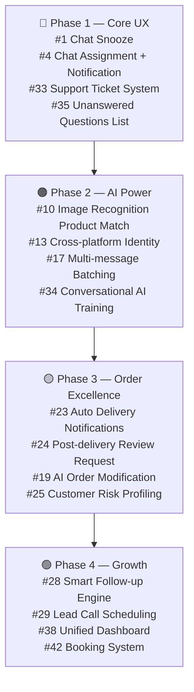

# 🚀 DriplareAI — Pending Features List
> **রেফারেন্স:** `docs/VideoScript.txt` (AI Proctor platform) বিশ্লেষণ করে বর্তমান DriplareAI প্রজেক্টের সাথে তুলনা করা হয়েছে।

---

## ✅ ইতিমধ্যে বাস্তবায়িত (Implemented)

| ফিচার | অবস্থান |
|---|---|
| Omnichannel Inbox (Facebook, WhatsApp, Instagram, Web Widget) | `app/(dashboard)/dashboard/inbox` |
| AI/Human toggle (`.` dot command) | `conversation-panel.tsx` — `onToggleStatus` |
| Archive/Unarchive chat | `conversation-panel.tsx` — `onToggleArchive` |
| Session search | `session-list.tsx` — `searchQuery` |
| Filter tabs (All, Tickets, Starred, Archived) | `live-inbox-header.tsx` |
| CRM Right Panel (contact info, tags, lead status, notes, order history) | `crm-panel.tsx` |
| Product Card Carousel in messages | `product-card-strip.tsx`, `message-bubble.tsx` |
| Assign to Agent (automation action) | `drafts.ts` — `assign_to_agent` |
| Order Management System | `app/(dashboard)/dashboard/orders` |
| Order status pipeline (Pending → Delivered) | `OrderSheet.tsx`, `StatusBadge.tsx` |
| Courier integration (Steadfast, Pathao, RedX) | `CourierConfig` schema |
| Bulk order dispatch | `app/api/orders/bulk-dispatch` |
| Courier sync / tracking | `app/api/orders/sync-courier`, `TrackingModal.tsx` |
| Discounts/Coupons | `app/(dashboard)/dashboard/discounts` |
| Broadcasts (bulk messaging) | `app/(dashboard)/dashboard/automations/broadcasts` |
| Smart Follow-up (Leads management) | `app/(dashboard)/dashboard/leads` |
| Automation Rules Engine | `app/(dashboard)/dashboard/automations` |
| Product Catalog (manual + CSV + FB post sync) | `app/(dashboard)/dashboard/products` |
| Stock tracking | `Product.stock` in schema |
| Knowledge Base (FAQ, Sample Replies, Files, Website, Text) | `app/(dashboard)/dashboard/knowledge-base` |
| AI Agent Analytics | `app/(dashboard)/dashboard/chatbots/[chatbotId]/analytics` |
| Conversation Summary (basic) | `crm-panel.tsx` — `aiSummary` (last 4 messages) |
| Shared Media Gallery | `SharedMediaAccordion` component |
| Repeat Customer badge | `crm-panel.tsx` |
| Billing (usage-based, no monthly fee) | `app/(dashboard)/dashboard/payment` |
| Multi-platform integration setup | `app/(dashboard)/dashboard/platforms` |
| Web Chat Widget | `app/widget` |
| n8n Automation Gate | `docs/n8n-JSON/` |
| Support Ticket tab in inbox | `constants.ts` — `tickets` filter |
| WhatsApp native webhook | `app/api/webhooks/whatsapp` |

---

## ❌ এখনো বাস্তবায়িত হয়নি (Pending Features)

> [!IMPORTANT]
> নিচের প্রতিটি ফিচার VideoScript-এ স্পষ্টভাবে উল্লেখিত, কিন্তু DriplareAI-তে এখনো নেই বা আংশিক।

---

### 🔵 Category 1: Inbox & Conversation UX

| # | ফিচার | VideoScript রেফারেন্স | বর্তমান অবস্থা |
|---|---|---|---|
| 1 | **Chat Snooze / Reminder** — নির্দিষ্ট সময়ে chat স্বয়ংক্রিয়ভাবে সামনে আসে | *"বলে দিন কখন দেখবেন। ঠিক সেই সময়ে chatটা সামনে চলে আসে"* | ❌ সম্পূর্ণ অনুপস্থিত — schema-তে `snoozeUntil` ফিল্ড নেই |
| 2 | **Seen → Typing → Reply** human-like delay simulation | *"আগে seen, তারপর typing, তারপর উত্তর"* | ❌ n8n-এ আংশিক কিন্তু DriplareAI dashboard-এ কোনো config নেই |
| 3 | **Full-text Chat Search** — message-এর ভেতরের কথা দিয়ে customer খোঁজা | *"নাম, ফোন নম্বর, order নম্বর এমনকি chat's ভেতরের যেকোনো একটা কথা লিখুন"* | ⚠️ নাম/session দিয়ে search আছে, কিন্তু message content full-text search নেই |
| 4 | **Chat Assignment to Specific Team Member** (with notification) | *"chatটা তাকে assign করে দিন। তিনি notification পান"* | ⚠️ Schema-তে `assignedToUserId` আছে কিন্তু UI assignment + notification সিস্টেম নেই |
| 5 | **Unlimited Team Members** (per-workspace) | *"Team member যোগ করুন যতজন খুশি। কোনো সীমা নেই"* | ⚠️ Workspace concept আছে কিন্তু team member invite/management UI নেই |
| 6 | **AI Moderator Assistant Panel** — conversation summary + যেকোনো প্রশ্ন + AI-generated reply suggestion | *"পুরো কথোপকথনের সারাংশ দেয়। কথোপকথন নিয়ে যেকোনো প্রশ্ন করুন... এখন customerকে কী পাঠালে সবচেয়ে ভালো হয়... এক ক্লিকে পাঠিয়ে দিন"* | ⚠️ আংশিক: basic aiSummary আছে (শেষ ৪টি assistant message), কিন্তু interactive Q&A বা one-click AI reply suggestion নেই |
| 7 | **Voice Message Handling in AI** — voice বুঝে text reply | *"Customer নিজের ভাষায় লিখুক বা voice বলুক কী চান"* | ⚠️ HumanInputBar-এ audio support আছে, কিন্তু AI-side voice transcription/processing অনিশ্চিত |
| 8 | **Quoted/Reply-to Message Handling** — আগের message টেনে এনে reply দিলে AI বোঝে | *"আগের কোনো message টেনে এনে reply দিলেন? সেটা ছবি হোক, voice হোক বা লেখা, agent ঠিক বোঝে কোনটার কথা হচ্ছে"* | ❌ অনুপস্থিত |
| 9 | **Chrome Extension** — Meta Business Suite থেকে AI সামলানো | *"আমাদের Chrome extension দিয়ে Business Suite থেকেই সব সামলানো যায়"* | ❌ সম্পূর্ণ অনুপস্থিত |

---

### 🟢 Category 2: AI Agent Capabilities

| # | ফিচার | VideoScript রেফারেন্স | বর্তমান অবস্থা |
|---|---|---|---|
| 10 | **Advanced Image Recognition** — যেকোনো ছবি দিলে catalog থেকে matching product খোঁজে পাঠায় | *"ছবিটা যেভাবেই তোলা হোক, দেখতে আপনার কোন product মতো। পুরো catalog সাথে মিলিয়ে ঠিক সেই পণ্যটা customerকে পাঠায়"* | ❌ সম্পূর্ণ অনুপস্থিত — vision-based product matching নেই |
| 11 | **Interactive Product Page** (no website needed) — buy now → order form → confirm → bill in chat | *"Buy Now tap করলেই order form সামনে। আরেক tap order confirm। Confirmation আর bill নিজেই chat চলে আসে"* | ⚠️ Product card আছে, কিন্তু standalone product page (chat-native checkout flow) সম্পূর্ণ নেই |
| 12 | **Quick-reply Buttons** — options automatically become tappable buttons | *"যেখানে customerকে কিছু বেছে নিতে হয়, সেখানে type করার ঝামেলা নেই। Optionগুলো নিজে থেকেই button হয়ে যায়"* | ⚠️ Product card-এ আছে কিন্তু general quick-reply button generation নেই |
| 13 | **Cross-platform Customer Identity** — একই customer-কে সব channel-এ চেনা | *"Customer যেখানেই যান, agent তাকে চেনে। আজ inbox কথা হলো। কাল একটা post comment করলেন..."* | ❌ প্রতিটি session আলাদা — cross-platform identity linking নেই |
| 14 | **Comment Auto-DM** — post comment করলে inbox-এ DM যায় + comment reply | *"এক ছবির post কেউ comment করলে agent সেই product ধরেই comment উত্তর দেয়। সাথে inbox message পাঠায়"* | ⚠️ n8n-এ comment handling আছে কিন্তু DriplareAI dashboard-এ comment-specific config/UI নেই |
| 15 | **Comment Re-engagement** — comment করে DM-এ সাড়া না দিলে কিছুক্ষণ পরে আবার মনে করায় | *"comment করে কেউ inbox সাড়া না দিলে? কিছু সময় পরে সেই comment আরেকবার মনে করিয়ে দেয়"* | ❌ অনুপস্থিত |
| 16 | **Spam/Junk Detection & Per-user AI Block** — এলোমেলো message করলে AI বন্ধ করে দেওয়া | *"একবার দেখে তার জন্য AI বন্ধ করে দিন। তার লেখা message AI এক পয়সাও আর খরচ হয় না"* | ⚠️ AI toggle (dot command) আছে, কিন্তু per-user AI disable (permanent block) নেই |
| 17 | **Multi-message Batching** — customer একসাথে অনেক message দিলে সব পড়ে একটি reply | *"Customer একসাথে অনেকগুলো message দিলে সবগুলো পড়ে, বুঝে এক messageই উত্তর দেয়"* | ❌ অনুপস্থিত — প্রতিটি message আলাদা প্রসেস হয় |
| 18 | **AI Practice Mode** — শুধু test message উত্তর দেয়, real customer-কে না | *"শুরুতে agent থাকে practice mode। শুধু আপনার test message উত্তর দেয়, আসল customer না"* | ⚠️ Playground আছে কিন্তু "practice mode" (real messages block) নেই |

---

### 🟡 Category 3: Order Management

| # | ফিচার | VideoScript রেফারেন্স | বর্তমান অবস্থা |
|---|---|---|---|
| 19 | **Order Modification Before Confirm** (via AI) — customer নিজেই AI দিয়ে order বদলায়, নতুন bill আসে | *"ঠিকানা, ফোন নম্বর, আরেকটা product যোগ... Agent নিজেই করে দেয় আর নতুন bill পাঠিয়ে দেয়"* | ❌ Order edit UI আছে, কিন্তু AI-driven order modification নেই |
| 20 | **Post-confirm Order Change Request** — confirm পরে চাইলে agent team-এ route করে | *"confirm হয়ে যাওয়ার পরে হলে? Agent অনুরোধটা লিখিয়ে নিয়ে chatটা আপনার teamকে দেয়"* | ❌ অনুপস্থিত |
| 21 | **Automated Parcel Booking** (one-click courier dispatch) | *"আপনার কাজ শুধু একটা click, parcel book। এর পরের সব ধাপ পুরোপুরি automatic"* | ⚠️ Steadfast/Pathao integration আছে, কিন্তু one-click full automation নেই |
| 22 | **Real-time Parcel Status Sync** (auto-update) | *"Parcel status কখন বদলালো, system নিজেই জেনে যায়"* | ⚠️ `sync-status` API আছে কিন্তু real-time/auto polling নেই |
| 23 | **Automated Customer Delivery Notifications** — courier update → inbox message (with tracking link) | *"Courier হস্তান্তর থেকে শুরু করে delivery দিন customerকে মনে করিয়ে দেওয়া পর্যন্ত... সুন্দর করে সাজানো professional update"* | ❌ Manual update, automated delivery notification pipeline নেই |
| 24 | **Post-delivery Review Request** — delivery পরে AI automatically review চায় | *"Delivery পরে customer অভিজ্ঞতা জানতে চেয়ে review অনুরোধও যায় নিজে থেকেই"* | ❌ সম্পূর্ণ অনুপস্থিত |
| 25 | **Customer Delivery Risk Profiling** — ফোন নম্বর দিয়ে return/cancel history দেখা + courier record | *"parcel পাঠানোর আগে customerকে চিনে নিন। ফোন নম্বর ধরে তার পুরো record... courier কাছে তার delivery record"* | ⚠️ Order history আছে (CRM panel), কিন্তু courier-level delivery risk scoring নেই |
| 26 | **COD Payment Collection Tracking** — delivery পরে টাকা পাওয়া গেছে কিনা আলাদা করে | *"Delivery পরে টাকা বাকি না হাতে এসেছে সেটাও আলাদা করে"* | ⚠️ `PaymentBadge.tsx` আছে, কিন্তু COD collection confirmation flow নেই |
| 27 | **Return/Damage/Cancellation Reason Tracking** | *"Return, damage, বাতিলের কারণ সব হিসাবে থাকে"* | ⚠️ Order status-এ `cancelled` আছে, কিন্তু structured reason tracking নেই |

---

### 🟠 Category 4: Smart Follow-up & Lead Engine

| # | ফিচার | VideoScript রেফারেন্স | বর্তমান অবস্থা |
|---|---|---|---|
| 28 | **Smart Follow-up Engine** — AI নিজে ঠিক করে কাকে কখন কী বললে ভালো হয় | *"সে নিজেই ঠিক করে কাকে কখন কী বললে ভালো হয় আর এটাও জানে কখন আর কিছু মনে করানো উচিত না"* | ⚠️ Basic follow-up automation আছে, কিন্তু AI-driven optimal timing নেই |
| 29 | **Lead Call Scheduling** — customer বললে "শুক্রবার ৫টায় call করুন", সেই সময়ে lead উঠে যায় | *"Customer বললেন, শুক্রবার বিকেল পাঁচটায় কল দিন। ঠিক সেই সময়টাই lead উঠে যায়"* | ❌ Lead page আছে, কিন্তু time-based reminder নেই |
| 30 | **Call Result Logging** — team call করে এক tap-এ ফলাফল লেখে | *"আপনার টিম কল দিয়ে এক ট্যাপে ফলাফলটা লিখে রাখে"* | ❌ অনুপস্থিত |
| 31 | **Lost Sale Reason Analytics** — কোন কারণে sale হারাচ্ছেন দেখা যায় | *"আপনি দেখতে পান কোন কারণে sale হারাচ্ছেন"* | ❌ অনুপস্থিত |
| 32 | **Re-engagement AI for Repeated Non-buyer** — বারবার আগ্রহ দেখিয়েও না কিনলে AI offer পাঠায় | *"কেউ বারবার আগ্রহ দেখিয়েও কিনছেন না? Agent তাকে product details আর একটা offer পাঠিয়ে convert করার চেষ্টা করে"* | ❌ অনুপস্থিত |

---

### 🔴 Category 5: Support Ticket System

| # | ফিচার | VideoScript রেফারেন্স | বর্তমান অবস্থা |
|---|---|---|---|
| 33 | **Structured Support Ticket System** — অভিযোগ/return/exchange-এর জন্য full ticket lifecycle | *"প্রতিটা সমস্যার জন্য খোলে একটা support ticket। কার দায়িত্বে আছে, কোন অবস্থায় আছে, কতদিন ধরে খোলা সব এক জায়গায়। যতক্ষণ না সমাধান হচ্ছে টিকিট খোলাই থাকে"* | ⚠️ Inbox-এ "tickets" filter tab আছে (UI label only), কিন্তু actual ticket management system (create/assign/resolve/SLA) নেই |

---

### 🟣 Category 6: AI Training & Feedback

| # | ফিচার | VideoScript রেফারেন্স | বর্তমান অবস্থা |
|---|---|---|---|
| 34 | **Conversational AI Training** — সাধারণ ভাষায় বলুন "এটা এভাবে বদলাও", AI বদলায় + test করে দেখায় | *"কোনো উত্তর পছন্দ হলো না? সাধারণ ভাষায় বলে দিন, এটা এভাবে বদলাও। Agent বদলায়, নিজেই test করে... আপনি হ্যাঁ বললে তবেই update"* | ⚠️ Knowledge base editing আছে, কিন্তু natural language AI retraining + preview + approve/reject flow নেই |
| 35 | **Unanswered Questions List** — AI কোন প্রশ্নের উত্তর দিতে পারেনি, কতবার এসেছে, পাশে শেখানোর button | *"customer কোন প্রশ্নগুলোর উত্তর agent দিতে পারেনি তারও একটা তালিকা থাকে। কোনটা কতবার এসেছে সেটা সহ। পাশেই button, উত্তরটা শিখিয়ে দিন"* | ❌ সম্পূর্ণ অনুপস্থিত |
| 36 | **One-click Rollback** — AI update পছন্দ না হলে এক ক্লিকে আগের অবস্থায় | *"পছন্দ না হলে এক ক্লিকে আগের অবস্থায়"* | ❌ অনুপস্থিত — prompt version history নেই |
| 37 | **Feature Request from within App** — app থেকে লিখে বা মুখে বলে নতুন feature request, progress দেখানো | *"নতুন কোনো feature দরকার মনে হলে app ভেতর থেকেই বলুন... আমরা সেটা নিয়ে কী করলাম সেটাও সেখানেই দেখতে পাবেন"* | ⚠️ Feedback system আছে কিন্তু voice input + feature tracking/status নেই |

---

### ⚫ Category 7: Analytics & Reporting

| # | ফিচার | VideoScript রেফারেন্স | বর্তমান অবস্থা |
|---|---|---|---|
| 38 | **Unified Business Dashboard** — আজ/গতকাল: কতগুলো কথা, কতগুলো order, AI কতটা সামলাল, কতবার মানুষ লাগলো | *"পুরো ব্যবসার হিসাব এক জায়গায়। আজ কী হলো, গতকাল কী হয়েছিল..."* | ⚠️ Overview page আছে, chatbot analytics আছে, কিন্তু unified cross-channel dashboard সম্পূর্ণ নেই |
| 39 | **Order Source Breakdown** — কোন order agent নিল, কোনটা product page থেকে এলো, কোনটা team নিল | *"কোন order agent নিল, কোনটা product page থেকে এলো, কোনটা আপনার টিম নিল"* | ❌ অনুপস্থিত — Order schema-তে `source` tracking নেই |
| 40 | **Interested-but-didn't-order List** | *"যারা আগ্রহ দেখিয়েও order করেননি তাদের আলাদা একটা তালিকা"* | ⚠️ Leads page আছে কিন্তু AI-generated "interested but not ordered" list নেই |
| 41 | **Per-reply AI Cost Breakdown** — billing page-এ প্রতিটি লাইনে কোন উত্তরে কত পয়সা কাটল | *"কোন উত্তরে কত পয়সা কাটল, billing page প্রতিটা লাইন ধরে লেখা"* | ⚠️ Usage page আছে, কিন্তু per-reply granular breakdown নেই |

---

### 🩵 Category 8: Service Business (Booking) Module

| # | ফিচার | VideoScript রেফারেন্স | বর্তমান অবস্থা |
|---|---|---|---|
| 42 | **Appointment/Booking System** — AI receptionist, booking নেওয়া, advance payment, appointment reminder | *"Service ব্যবসা হলে এই agentই আপনার receptionist। Booking নেয়, advance transaction ID রাখে, আগের দিন মনে করিয়ে দেয়"* | ❌ সম্পূর্ণ অনুপস্থিত |

---

## 📊 সারসংক্ষেপ

```
মোট pending ফিচার: 42
সম্পূর্ণ অনুপস্থিত (❌): 21
আংশিক (⚠️): 21
```

| Priority | Category | Pending Count |
|---|---|---|
| 🔵 High | Inbox & Conversation UX | 9 |
| 🟢 High | AI Agent Capabilities | 9 |
| 🟡 Medium | Order Management | 9 |
| 🟠 Medium | Smart Follow-up & Leads | 5 |
| 🔴 High | Support Ticket System | 1 |
| 🟣 Medium | AI Training & Feedback | 4 |
| ⚫ Low | Analytics & Reporting | 4 |
| 🩵 Low | Service Business (Booking) | 1 |

---

## 🎯 প্রস্তাবিত প্রাধান্য ক্রম (Recommended Priority)



> [!NOTE]
> Chrome Extension (#9) টা technically সম্পূর্ণ আলাদা একটি প্রজেক্ট। এটি Phase 4 বা পরেও করা যেতে পারে।

> [!TIP]
> **সহজতম শুরু:** `#35 Unanswered Questions List` এবং `#1 Chat Snooze` — দুটোই database schema change + UI, backend logic সহজ।
