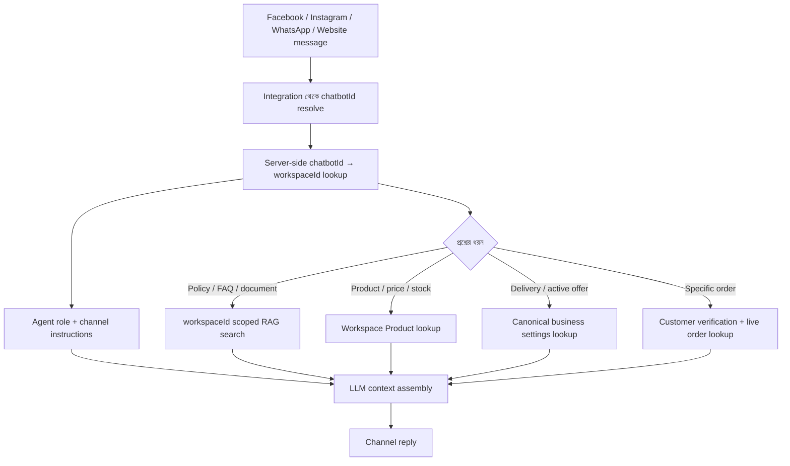

# Business Knowledge, AI Agent Roles ও Onboarding পরিকল্পনা

> **স্ট্যাটাস:** Business Knowledge, Workspace data ownership, structured delivery rates, Agent onboarding ও repository n8n workflow বাস্তবায়িত। Database migration apply, production n8n deploy এবং live acceptance review বাকি।
>
> **উদ্দেশ্য:** একটি Workspace-এর business information একবার সংরক্ষণ করে সেই Workspace-এর সব AI Agent-কে নিরাপদে ব্যবহার করতে দেওয়া; Agent-ভেদে শুধু role, কাজ, channel behavior ও অনুমোদিত action আলাদা রাখা।

## ১. মূল সিদ্ধান্ত

**Business Knowledge হবে shared business context-এর জায়গা; এটি Products, Orders, Courier বা Discounts-এর duplicate database হবে না।** Merchant operational data তার বর্তমান sidebar panel-এ পরিচালনা করবেন। Business Knowledge থেকে সেই data-কে একত্রে দেখা, AI-এর জন্য ব্যবহার এবং সাধারণ business policy/document যোগ করা যাবে।

প্রতিটি AI Agent একই Workspace-এর Business Knowledge পাবে। Agent-এর নিজস্ব পরিচয়, role, কাজের সীমা ও channel অনুযায়ী আচরণ আলাদা থাকবে। Agent-এ shared product, delivery বা policy data copy করে রাখা হবে না।

```text
Workspace / Business
├── Business Knowledge ও Business Rules — সব Agent-এর জন্য shared
├── Products, Delivery, Offers — canonical operational data
├── Orders ও Customer Records — live, access-controlled business records
└── AI Agents
    ├── Agent A: Social Sales & Support — Facebook + Instagram
    ├── Agent B: Website & WhatsApp Order Assistant
    └── Agent C: Seasonal Campaign Agent — নির্বাচিত campaign-এ অগ্রাধিকার
```

## ২. বর্তমান architecture থেকে যা জানা গেছে

বর্তমান code-এ Workspace-level knowledge-এর কিছু ভিত্তি ইতিমধ্যে আছে:

- `Source`-এ `workspaceId` ও `isGlobal` আছে; `Chunk.metadata`-তেও workspace scope রাখা যায়। Workspace FAQ এবং document এই scope-এ সংরক্ষণ করা হচ্ছে।
- App-এর `getContext(chatbotId, ..., workspaceId)` এবং n8n-এর `RAG Search`—দুটিই chatbot-এর নিজস্ব chunks-এর পাশাপাশি ঐ Workspace-এর `isGlobal` source chunks খোঁজে।
- Workspace AI Rules prompt-এ server-side যোগ হয়; Agent-এ rules কপি করার দরকার হয় না।
- `CustomTableSchema`-এ `workspaceId` আছে, কিন্তু `CustomRecord` মূলত `chatbotId`-এর সঙ্গে যুক্ত।

কিছু গুরুত্বপূর্ণ data এখনও Agent-ভিত্তিক:

- `Product`, `Order` ও `EcommerceConfig`-এর ownership `chatbotId`-ভিত্তিক। একই business-এর একাধিক Agent হলে এক Agent-এর catalog/config অন্য Agent-এ স্বয়ংক্রিয়ভাবে পাওয়া নিশ্চিত নয়।
- `CourierConfig`-এ `workspaceId` থাকলেও এটি `userId`-এর সঙ্গে unique—একজন merchant-এর একাধিক business থাকলে এই ownership পুনরায় যাচাই করা দরকার।
- Category থেকে তৈরি custom schemas Workspace-এর সঙ্গে যুক্ত হতে পারে; prompt sync একই Workspace-এর schemas একাধিক Agent-এর prompt-এ যোগ করতে পারে। কিন্তু সব Agent-এর সব form ব্যবহার করার অনুমতি থাকা উচিত কি না, তার role-based নিয়ম এখন স্পষ্ট নয়।
- `/api/chatbots/[chatbotId]/chat` শুধু যাচাইকৃত `chatbotId` n8n-এ পাঠায়। `Core-AI-Brain.json`-এর `Fetch Bot Config` DB থেকে ঐ Agent-এর `workspaceId` resolve করে; `RAG Search` সেই ID দিয়ে `Source.workspaceId` এবং `isGlobal` filter করে। তাই customer-facing n8n RAG-এ Workspace scope আগে থেকেই আছে, client থেকে `workspaceId` বিশ্বাস করার দরকার নেই।
- n8n-এর `Product Lookup`, `Fetch Product Cards` ও `Order Created Check` এখনও `chatbotId` দিয়ে query করে। `EcommerceConfig`-ও chatbot-scoped।

Repository-তে `docs/n8n-JSON/Core-AI-Brain.json` ও channel workflow export আছে। Export-এ Workspace rules এবং global RAG scope দেখা যায়; live deployed workflow-এর সঙ্গে export-এর parity আলাদাভাবে যাচাই করতে হবে। Product/Order lookup-এর ownership এখনও `chatbotId`-ভিত্তিক।

### বাস্তবায়নের অগ্রগতি

- [x] Workspace Knowledge Base-এর UI label **Business Knowledge** করা হয়েছে।
- [x] Business Knowledge-এ Overview, FAQs, Sample Replies, Business Data, Documents, Learn from Conversations এবং Business Rules সাজানো হয়েছে। Agent scope-এ shared FAQ/Sample Reply tab duplicate হয় না; শুধু Agent Instructions ও optional private references থাকে।
- [x] Business Data profile, summary count এবং existing Products, Orders, Courier, Discounts ও Business Records module-এ deep link দেখায়। Text/voice description থেকে AI suggestion আসে; merchant review করে apply এবং আলাদা করে save করেন।
- [x] Product, Order, Courier ও MerchantCoupon-এর Workspace ownership এবং legacy-data fallback/backfill যোগ হয়েছে। Agent-origin `chatbotId` audit-এর জন্য থাকে।
- [x] Legacy EcommerceConfig-এর Workspace owner/backfill যোগ হয়েছে; n8n এখন Workspace config নেয় এবং legacy Agent config-এ fallback করে।
- [x] Business Data profile-এ delivery area, area aliases, charge, estimated time এবং free-delivery threshold-এর structured form যোগ হয়েছে; order tool matching area ও confirmed fee server-side যাচাই করে।
- [x] n8n export Workspace profile/rules, active offer, shared RAG ও Product lookup ব্যবহার করে; customer order lookup-এর জন্য order ID এবং checkout phone যাচাই করে scoped endpoint/tool যোগ হয়েছে।
- [x] Agent role/instruction prompt-এ যায়; custom form access allowlist দিয়ে সীমিত। Widget-সহ app chat path-গুলো saved role পড়ে।
- [x] Sidebar Setup Guide বাস্তব saved state থেকে ৮টি ধাপের progress দেখায়; checklist complete হলেও entry লুকায় না।
- [x] Agent Setup checklist role → shared knowledge → channel → Playground test-এর real saved state দেখায়।
- [ ] Migration apply করে live DB-তে multi-Agent isolation/lookup acceptance এবং production n8n deployment যাচাই।

## ৩. UI ও তথ্যের কাঠামো

### ৩.১ Knowledge Base পেজের পরিচয়

- **Workspace Knowledge Base** নামটি বদলে **Business Knowledge** হবে। Badge-এ থাকবে “সব Agent-এর সঙ্গে shared”।
- **Agent-Specific Knowledge**-কে **Agent Instructions** হিসেবে উপস্থাপন করা হবে, যাতে Merchant বুঝতে পারেন এখানে business facts duplicate না করে Agent-এর কাজ নির্ধারণ করতে হয়।
- Shared scope-এর FAQs, Sample Replies, Content Training ও Auto-Train বারবার Agent scope-এ দেখানো হবে না। Agent-specific reference দরকার হলে সেটি আলাদা optional section হবে।

### ৩.২ Business Knowledge tabs

বাস্তবায়িত tab ক্রম:

1. **Overview** — Business setup-এর অবস্থা ও দ্রুত action।
2. **FAQs** — সব Agent-এর জন্য সাধারণ business প্রশ্নোত্তর।
3. **Sample Replies** — ব্যবসার পছন্দের response style।
4. **Business Data** — profile, operational summary ও source-of-truth module link।
5. **Documents** — file, website content ও অন্যান্য reference source।
6. **Learn from Conversations** — conversation থেকে তৈরি knowledge proposal review/approve করা।
7. **Business Rules** — সব Agent-এর জন্য shared আচরণ ও সীমা।

পুরোনো “Content Training” এবং “Auto-Train Engine” শব্দ Merchant-এর কাছে কী করবে তা স্পষ্ট করে না। তাদের জন্য **Documents** এবং **Learn from Conversations** বেশি কাজ-ভিত্তিক label হবে।

### ৩.৩ Business Data tab

Business Data প্রতিটি বিভাগের summary, readiness ও বর্তমান data দেখাবে। Existing operational panel-এ **Manage** link থাকবে; একই তথ্যের দ্বিতীয় editor/table তৈরি হবে না।

| বিভাগ | Business Data-তে কী দেখা যাবে | মূল সম্পাদনার জায়গা |
|---|---|---|
| Business Profile | নাম, business type, ঠিকানা, যোগাযোগ, খোলার সময় | Workspace/Business setup |
| Products | active product সংখ্যা, stock status, catalog completeness | Products |
| Delivery & Fulfillment | merchant-entered delivery area/charge/timing ও courier readiness | Business profile/Rules এবং Courier Settings |
| Offers & Campaigns | active discount, সময়সীমা ও campaign | Discounts & Coupons |
| Orders | সাম্প্রতিক order ও fulfillment summary | Orders |
| Policies | payment, return, exchange, cancellation ও সাধারণ নিয়ম | Business Knowledge/Rules |

Business Data profile-এ text বা browser voice input দিয়ে তথ্য বর্ণনা করলে AI field suggestion সাজায়। Merchant preview করে apply করেন; পরে profile-এর Save চাপলে তবেই persistence হয়। Suggestion endpoint profile পরিবর্তন করে না। AI কোনো price, delivery charge বা policy নীরবে পরিবর্তন করে না।

### ৩.৪ Agent Instructions

প্রতিটি Agent-এর জন্য সংক্ষিপ্ত role setup:

- Agent-এর নাম ও উদ্দেশ্য।
- Role template: Social Sales & Support, Order Assistant, Reception/Booking Agent, Campaign Agent ইত্যাদি।
- দায়িত্ব ও কোন প্রশ্নে উত্তর দেবে।
- tone, escalation/human handoff এবং নিষিদ্ধ কাজ।
- কোন platform/channel-এ কাজ করবে—Platform assignment-এর existing source of truth থেকেই status দেখানো হবে।
- Agent-এর জন্য অনুমোদিত custom forms/actions।

Channel binding এবং role instruction একই জিনিস নয়: Platform পেজ channel connect/assign করবে; Agent Instructions বলবে সেই channel-এ Agent কীভাবে কাজ করবে।

ঈদ Campaign Agent shared Offers data ব্যবহার করবে। Agent instruction-এ “নির্বাচিত ঈদ campaign-কে অগ্রাধিকার দাও” থাকবে; discount-এর amount ও date Business Data-তে একবারই থাকবে।

## ৪. Business Knowledge ও operational sidebar data-এর সম্পর্ক

Sidebar-এর Products, Orders, Courier Settings ও Discounts নিজ নিজ operational data-এর source of truth থাকবে। Business Knowledge তাদের সঙ্গে যুক্ত shared AI context হবে।

- Product price/stock-এর মতো পরিবর্তনশীল মান Structured Product record থেকে পড়া হবে। Product description বা দীর্ঘ বিবরণ semantic search-এও index করা যেতে পারে।
- Delivery charge/area/time canonical settings থেকে পড়া হবে। Courier API credentials এবং customer-কে বলা delivery policy আলাদা data হিসেবে রাখা হবে।
- Coupon-এর সক্রিয়তা ও সময়সীমা Discounts panel-এর canonical record থেকে পড়া হবে। Agent campaign instruction দিতে পারে, কিন্তু offer-এর তথ্য কপি করবে না।
- Orders UI-তে Business Data summary থাকতে পারে। Individual order lookup customer verification-এর পরে live database থেকে হবে।
- Order processing, cancellation, delivery ও return-এর সাধারণ policy Business Rules/Knowledge-এ থাকবে; ব্যক্তিগত order record RAG knowledge হিসেবে ছড়ানো হবে না।

## ৫. n8n-এ Agent উত্তর তৈরির প্রস্তাবিত flow



### Scope ও security

1. Incoming platform integration থেকে `chatbotId` নির্ধারিত হবে।
2. Trusted server/database lookup থেকে সেই Agent-এর `workspaceId` বের হবে। Browser পাঠানো `workspaceId`-কে একা বিশ্বাস করা যাবে না।
3. Server-to-server n8n request-এ workspace scope authenticated/signed ভাবে যাবে, অথবা n8n একটি signed internal context API ব্যবহার করবে।
4. Workspace retrieval query-তে একই `workspaceId` বাধ্যতামূলক হবে। অন্য Workspace-এর source বা product কখনও ফলাফলে আসবে না।
5. LLM-কে database credentials দেওয়া হবে না। Product/order create বা update action validated API/tool-এর মাধ্যমে হবে।
6. Order lookup-এ order number-এর পাশাপাশি customer identity যাচাই করে প্রয়োজনীয় field-ই ফেরত দিতে হবে।

### Retrieval-এর ধরন

- **RAG retrieval:** FAQ, policy, documents, দীর্ঘ product descriptions। `Chunk` metadata-তে `workspaceId`, `sourceId`, `type` ও প্রযোজ্য `entityId` থাকবে।
- **Structured lookup:** current price, stock, delivery settings, active offer। DB/API থেকে fresh value পড়বে; vector result একা final authority হবে না।
- **Live transactional lookup:** নির্দিষ্ট order, delivery tracking ও customer record। পরিচয়/authorization checks-এর পরে সীমিত query হবে।

## ৬. Data কোথায় save হবে এবং কীভাবে update হবে

| Data type | প্রস্তাবিত owner/scope | Search/update strategy |
|---|---|---|
| Workspace FAQ ও documents | `workspaceId` | PostgreSQL source + chunks/vector; edit/delete হলে সংশ্লিষ্ট chunk update/delete |
| Business rules/profile | Workspace | Structured fields এবং প্রয়োজনে readable prompt/context |
| Products | Workspace catalog | Structured lookup; description-এর জন্য optional companion vector source |
| Delivery policy | Workspace profile/Business Rules | structured delivery-zone lookup ও order-create server-side fee validation |
| Active offers | Workspace | MerchantCoupon থেকে active window অনুযায়ী structured lookup |
| Orders | Workspace transaction | Live DB query; RAG embedding নয় |
| Agent role/instructions | `chatbotId` | Prompt assembly-তে Workspace rules-এর সঙ্গে combine |
| Custom schemas | Workspace | Agent role/capability অনুযায়ী form access |
| Custom records | Workspace + originating Agent/session | Structured record; audit/provenance অক্ষত থাকবে |

বর্তমান Product ও EcommerceConfig chatbot-scoped ছিল। Workspace migration-এ row owner যোগ হয়; Product-এ পুরোনো Agent provenance থাকে এবং duplicate product auto-merge হয় না। EcommerceConfig-এ Workspace owner backfill হয়, আর পুরোনো unscoped row agent fallback হিসেবে থাকে।

Orders-ও এখন `chatbotId`-ভিত্তিক। Workspace-এর সব Agent-কে নিরাপদে order history দেখতে দিতে order scope Workspace-এ আনা বা Workspace-এর Agent IDs দিয়ে ধারাবাহিকভাবে query করতে হবে। কোন Agent order তৈরি করেছে তা audit-এর জন্য রাখতে হবে।

## ৭. Category-ভিত্তিক business data table-এর প্রভাব

Workspace category অনুযায়ী তৈরি table—যেমন clinic appointment, restaurant reservation বা travel inquiry—**কোন data collect হবে তা নির্ধারণ করে**। এগুলো Business Knowledge facts নয়; AI action/workflow-এর structured schema।

- Schema definition Workspace-এ একবার থাকবে।
- Role অনুযায়ী Agent-কে নির্দিষ্ট schema/form ব্যবহার করার permission দেওয়া হবে।
- CustomRecord-এ Workspace, originating Agent এবং session/customer linkage থাকবে।
- Prompt assembly-তে সব Workspace form সব Agent-কে নির্বিচারে দেওয়া হবে না।
- E-commerce-এর Products/Orders/Courier-এর জন্য custom table দিয়ে parallel data source বানানো হবে না; existing operational model-ই ব্যবহার হবে।

## ৮. Workspace তৈরি ও Setup Guide

Workspace creation modal-এ নাম, category ও optional logo/title-এর মতো অল্প তথ্য থাকবে। Modal-এ পুরো business profile/product/delivery form ঢোকানো হবে না; business create করার পর guided setup-এ Merchant ধাপে ধাপে তথ্য দেবেন।

### প্রথম Workspace-এর Setup Guide

1. **Business profile** — নাম/category prefilled; contact, location, hours যোগ।
2. **Products বা services** — catalog যোগ/import বা existing system connect।
3. **Operations** — E-commerce-এ delivery/payment/returns; Clinic-এ appointment rules; Restaurant-এ booking/delivery ইত্যাদি।
4. **Business Knowledge** — FAQ, policy, documents।
5. **প্রথম AI Agent** — role ও responsibilities নির্ধারণ।
6. **Channel connect ও assign** — Platform flow থেকে channel যুক্ত করা।
7. **Test** — Playground-এ sample question চালানো।
8. **Live** — Agent live mode-এ দিয়ে customer conversation চালু করা।

Sidebar-এর উপরে compact **Setup Guide · 0/8** entry থাকবে। Profile, catalog/service forms, operations, knowledge, agent, channel, test ও live—এই আট ধাপের checklist খুলবে; প্রতিটি অসম্পূর্ণ ধাপে সংশ্লিষ্ট কাজের link থাকবে।

Progress কেবল বাস্তব saved state থেকে গণনা হবে। উদাহরণ: order table খালি থাকাকে onboarding অসম্পূর্ণ বলা হবে না; E-commerce setup-এর জন্য catalog বা delivery rules প্রাসঙ্গিক। Step complete হওয়ার পর checkmark থাকবে। Guide collapse করা যাবে, কিন্তু অপ্রত্যাশিতভাবে নিজে থেকে অদৃশ্য হবে না।

একই Workspace-এ পরের Agent তৈরি হলে সংক্ষিপ্ত **Add Agent** flow দেখাবে: role → channel assignment → authorized data/forms review → test। Business information আবার চাইবে না।

## ৯. বাস্তবায়নের ধাপ

### Phase 1 — Data ownership ও n8n audit

- [ ] Production n8n workflow export-এর সঙ্গে repository JSON diff করে production deployment যাচাই।
- [x] Repository workflow-এ `chatbotId → workspaceId` server-side database lookup যাচাই।
- [x] Product, Order, Courier, offer ও custom form-এর source of truth চিহ্নিত।
- [x] Read/write permission map-এ order create, phone-verified lookup এবং role-based form save নির্দিষ্ট।

### Phase 2 — Workspace data model ও migration

- [x] Product ও Order-এ Workspace owner/backfill যোগ; existing product row delete/merge না করে merchant review-এর জন্য রাখা।
- [x] CourierConfig Workspace-keyed; legacy user config migration-এ প্রথম Workspace-এ যুক্ত।
- [x] EcommerceConfig-এ Workspace scope/backfill; n8n workspace-first settings lookup।
- [x] Order Workspace scope এবং originating Agent/session provenance রাখা; customer lookup-এ order ID + checkout phone লাগে।
- [x] Custom schema/record Workspace-aware; form submit করার আগে Agent allowlist যাচাই।
- [ ] Migration target DB-তে apply এবং multi-workspace courier legacy assignment review।

### Phase 3 — n8n context ও tools

- [x] n8n incoming Agent-কে database-এ resolve করে তার Workspace, rules, profile ও role পড়ে।
- [x] Shared RAG query-তে Workspace `isGlobal` Source filter enforce করা।
- [x] Product ও active offer live structured lookup; delivery detail Workspace profile/Rules থেকে fresh prompt context।
- [x] Order lookup-এ order ID এবং checkout phone match না করলে কোনো order detail ফেরত আসে না।
- [x] Product/knowledge edit ও delete-এ companion Source/chunk refresh বা cleanup রাখা।
- [x] Delivery zone অনুযায়ী fee server-side নির্ধারণ/যাচাই করার structured settings ও order validation।

### Phase 4 — Business Knowledge ও Business Data UI

- [x] Workspace Knowledge Base → **Business Knowledge**; overview ও task-oriented tabs।
- [x] Agent-Specific Knowledge → **Agent Instructions**; shared FAQs/Replies Agent scope-এ duplicate হয় না।
- [x] Business Data overview, profile, count summary ও existing module deep links।
- [x] Text/voice-assisted profile suggestion; preview/apply/save আলাদা action।

### Phase 5 — Role ও Setup Guide

- [x] Role templates, channel assignment status, responsibilities, tone, handoff ও boundary UX।
- [x] Agent-specific custom form allowlist; default কোনো form অনুমোদিত নয়।
- [x] Workspace first-run guide এবং প্রতিটি Agent-এর role → knowledge → channel → test checklist।

### Phase 6 — Migration validation ও acceptance

- [ ] এক Workspace-এ অন্তত তিন Agent দিয়ে shared policy/product/delivery acceptance।
- [ ] Agent role/channel instruction আলাদা থাকে এবং পরিবর্তন সঠিক Agent-এ সীমিত থাকে তা যাচাই।
- [ ] Agent A-এর product edit Agent B/C-তে পরের query-তেই দেখা যায় তা যাচাই।
- [ ] Order ব্যক্তিগত তথ্য অন্য Workspace বা unverified phone-এ ফেরত না যায় তা যাচাই।
- [ ] Custom form শুধু allowlist-এ থাকা Agent-এ available তা যাচাই।

## ১০. গ্রহণযোগ্যতার শর্ত

- Merchant business fact একবার যোগ করে; একই তথ্য Agent-এ copy করতে হয় না।
- Products, delivery, offers ও policy-র প্রতিটির একটিই canonical source থাকে।
- Workspace-এর সব Agent shared data পায়, কিন্তু অন্য Workspace-এর data পায় না।
- Agent-specific role shared facts-কে override না করে; Business Rules-এর precedence স্পষ্ট থাকে।
- Customer order live source থেকে, identity checks-এর পরে পড়া হয়।
- Category-created custom schemas Workspace-এ shared, কিন্তু Agent access role অনুযায়ী সীমিত।
- Workspace creation থেকে first Agent Live করা পর্যন্ত Setup Guide বাস্তব অগ্রগতি দেখায়।

## ১১. স্থির করা সিদ্ধান্ত ও deploy-পূর্ব কাজ

1. Repository n8n export-এ Workspace RAG ও order verification আছে; production workflow-এর সঙ্গে diff/deploy এখনো হয়নি।
2. Product-এর canonical owner Workspace। Legacy `chatbotId` provenance থাকে; migration duplicate product delete বা auto-merge করে না, তাই merchant review লাগতে পারে।
3. CourierConfig এখন Workspace-scoped। Legacy user-level credential প্রথম তৈরি Workspace-এ backfill হয়; অন্য Workspace-এ আলাদা credential configure করতে হবে।
4. Custom form access Agent-এর `allowedFormSlugs` allowlist দিয়ে; নতুন Agent-এর default allowlist খালি।
5. Delivery details ও structured delivery zones Workspace profile-এ shared; matched address zone অনুযায়ী fee, free-delivery threshold ও confirmed total order create-এ যাচাই হয়। অস্পষ্ট বা unmatched address-এ order reject করে team clarification চায়।
6. Database migration এখনো apply করা হয়নি; live database ও production n8n deploy/acceptance পরবর্তী অপারেশনাল ধাপ।

